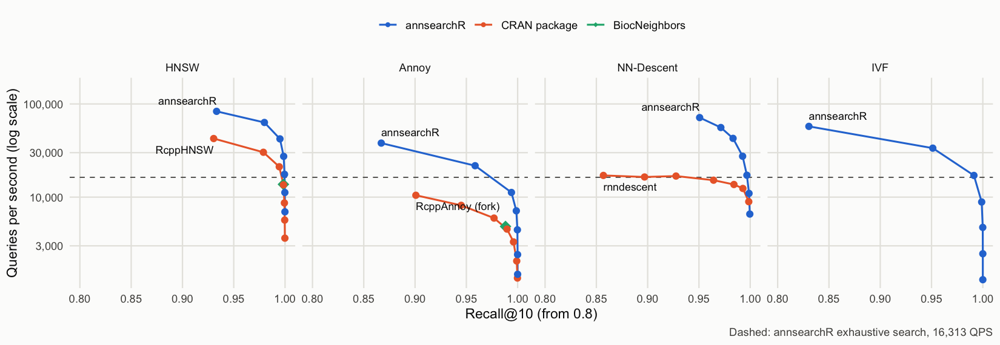
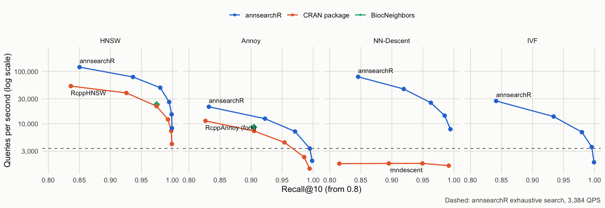
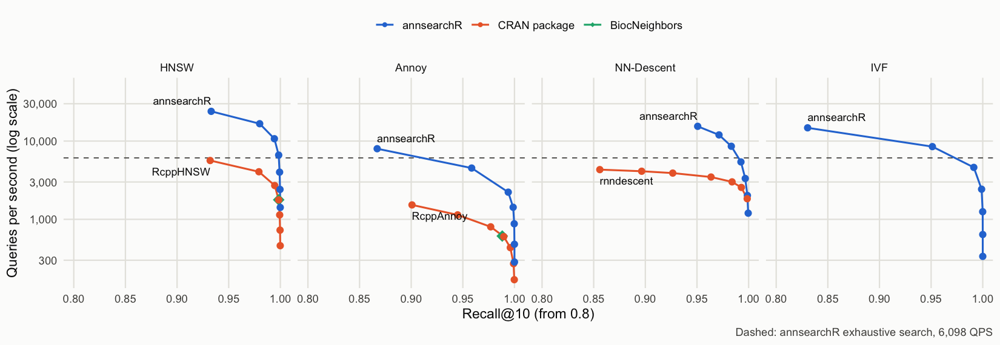

# Benchmarks against the R ecosystem

How does annsearchR stack up against the nearest neighbour packages R
users actually reach for? We ran the
[ann-benchmarks](https://ann-benchmarks.com) protocol on two of its
standard datasets and compared every library at **equal recall**, not at
equal settings. Two libraries with the same `ef_search` can land at
different recall, so “faster at the same parameters” says little.
Instead each library builds once, its search-time knob is swept, and we
read off the best queries per second (QPS) it reaches at recall@10 of
0.90, 0.95 and 0.99.

These are numbers from one machine on one day with annsearchR 0.2.0
(ann-search-rs 0.12.2), frozen here rather than rebuilt with the
package. Everything needed to rerun them is in
[`inst/benchmarks/`](https://github.com/GregorLueg/annsearchR/tree/main/inst/benchmarks).

## Setup

- **Machine:** Apple M1 Max, 10 cores (8 performance, 2 efficiency),
  macOS.
- **Datasets:**
  [Fashion-MNIST](https://github.com/zalandoresearch/fashion-mnist),
  60,000 x 784 (28 x 28 greyscale product photos), and SIFT-128,
  1,000,000 x 128 (local image descriptors). Both use 10,000 held-out
  queries, k = 10, Euclidean distance and the ground truth that ships
  with the HDF5 files.
- **Matched build parameters:** HNSW at M = 16 and ef_construction =
  200; Annoy at 50 trees; NN-Descent graphs of degree 30.
- **Swept at query time:** HNSW and NN-Descent `ef_search` from 10 to
  640; Annoy `search_k` from 500 to 50,000; IVF `nprobe` from 2 to 128;
  rnndescent’s `epsilon` from 0 to 0.3.
- **Libraries:** annsearchR (Rust, via ann-search-rs), RcppHNSW
  (hnswlib), RcppAnnoy (Spotify’s Annoy), BiocNeighbors (KMKNN, plus
  hnswlib and Annoy), rnndescent (NN-Descent), FNN and RANN (exact
  kd-trees).

Each point is a single timed run over all 10,000 queries. Two repeat
runs of the Fashion-MNIST sweep agreed within about 5% for most points,
but one rnndescent point moved 1.5x between runs, so read small gaps as
ties.

## Results

Each panel is one algorithm family. Up and to the right is better. The
dashed line is annsearchR’s exact brute-force search: an approximate
index below it isn’t worth building on that data.

### Fashion-MNIST, 10 threads



Recall vs queries per second on Fashion-MNIST with 10 threads, one panel
per algorithm family

| Method     | Library          | Build (s) | QPS @ 0.90 | QPS @ 0.95 | QPS @ 0.99 |
|------------|------------------|----------:|-----------:|-----------:|-----------:|
| hnsw       | **annsearchR**   |       3.7 |     83,333 |     63,291 |     42,194 |
| hnsw       | RcppHNSW         |       8.6 |     42,553 |     30,303 |     21,186 |
| hnsw       | BiocNeighbors    |      66.6 |     13,717 |     13,717 |     13,717 |
| nndescent  | **annsearchR**   |       2.3 |     71,429 |     71,429 |     27,473 |
| nndescent  | rnndescent       |      15.1 |     16,835 |     15,198 |     12,392 |
| ivf        | **annsearchR**   |       1.4 |     33,557 |     33,557 |     17,094 |
| annoy      | **annsearchR**   |       1.7 |     21,739 |     21,739 |     11,223 |
| annoy      | RcppAnnoy (fork) |      16.4 |     10,471 |      5,956 |      3,306 |
| annoy      | BiocNeighbors    |      15.7 |      4,845 |      4,845 |        n/a |
| exhaustive | **annsearchR**   |       0.1 |     16,313 |     16,313 |     16,313 |
| kmknn      | **annsearchR**   |       1.3 |      2,147 |      2,147 |      2,147 |
| kmknn      | BiocNeighbors    |     116.4 |        783 |        783 |        783 |
| kd_tree    | RANN             |        \- |         31 |         31 |         31 |
| kd_tree    | FNN              |        \- |         30 |         30 |         30 |

### SIFT-128, 10 threads



Recall vs queries per second on SIFT-128 with 10 threads, one panel per
algorithm family

| Method     | Library          | Build (s) | QPS @ 0.90 | QPS @ 0.95 | QPS @ 0.99 |
|------------|------------------|----------:|-----------:|-----------:|-----------:|
| hnsw       | **annsearchR**   |      42.6 |     78,125 |     48,780 |     26,042 |
| hnsw       | RcppHNSW         |      85.1 |     38,760 |     21,645 |     12,107 |
| hnsw       | BiocNeighbors    |     564.3 |     23,310 |     23,310 |        n/a |
| nndescent  | **annsearchR**   |      22.0 |     46,083 |     25,189 |      7,874 |
| nndescent  | rnndescent       |     188.4 |      1,754 |      1,588 |      1,588 |
| ivf        | **annsearchR**   |       1.9 |     13,736 |      6,920 |      3,597 |
| annoy      | **annsearchR**   |       7.0 |     12,500 |      7,123 |      3,369 |
| annoy      | BiocNeighbors    |      79.0 |      8,606 |        n/a |        n/a |
| annoy      | RcppAnnoy (fork) |      83.7 |      7,267 |      4,407 |      1,393 |
| exhaustive | **annsearchR**   |       0.4 |      3,384 |      3,384 |      3,384 |
| kmknn      | **annsearchR**   |       2.2 |        500 |        500 |        500 |
| kmknn      | BiocNeighbors    |     858.3 |        273 |        273 |        273 |
| kd_tree    | RANN             |        \- |          6 |          6 |          6 |
| kd_tree    | FNN              |        \- |          6 |          6 |          6 |

### Fashion-MNIST, 1 thread

The ann-benchmarks convention, and the fair fight for the
single-threaded RcppAnnoy, FNN and RANN.



Recall vs queries per second on Fashion-MNIST with 1 thread, one panel
per algorithm family

| Method     | Library        | Build (s) | QPS @ 0.90 | QPS @ 0.95 | QPS @ 0.99 |
|------------|----------------|----------:|-----------:|-----------:|-----------:|
| hnsw       | **annsearchR** |      15.9 |     23,981 |     16,667 |     10,718 |
| hnsw       | RcppHNSW       |      67.2 |      5,643 |      4,054 |      2,704 |
| hnsw       | BiocNeighbors  |      66.8 |      1,776 |      1,776 |      1,776 |
| nndescent  | **annsearchR** |      11.6 |     15,432 |     15,432 |      5,414 |
| nndescent  | rnndescent     |      77.0 |      3,899 |      3,471 |      2,556 |
| ivf        | **annsearchR** |       1.9 |      8,496 |      8,496 |      4,608 |
| annoy      | **annsearchR** |       5.7 |      4,521 |      4,521 |      2,223 |
| annoy      | RcppAnnoy      |      15.7 |      1,528 |        802 |        435 |
| annoy      | BiocNeighbors  |      15.5 |        611 |        611 |        n/a |
| exhaustive | **annsearchR** |       0.1 |      6,098 |      6,098 |      6,098 |
| kmknn      | **annsearchR** |       1.9 |        674 |        674 |        674 |
| kmknn      | BiocNeighbors  |     116.5 |        100 |        100 |        100 |
| kd_tree    | RANN           |        \- |         31 |         31 |         31 |
| kd_tree    | FNN            |        \- |         30 |         30 |         30 |

## What the numbers say

- **HNSW:** annsearchR runs about 2x the queries per second of RcppHNSW
  at every recall target on both datasets with 10 threads, and builds 2
  to 2.3x faster. Recall at the same `ef_search` is within about 0.02 of
  RcppHNSW’s, so the graphs are of the same quality; the Rust search is
  just quicker. On one thread the gap widens to 4 to 4.3x: RcppHNSW
  gains more from extra threads than annsearchR does.
- **NN-Descent:** against rnndescent, 4.2x faster at recall 0.90 on
  Fashion-MNIST and 26x on SIFT, with builds 6.5 to 8.5x faster.
- **Annoy:** RcppAnnoy has no threads and no batch query, so the only
  way to use more cores from R is forking over query chunks with
  [`parallel::mclapply`](https://rdrr.io/r/parallel/mclapply.html).
  That’s what the “(fork)” rows are, fork cost included. annsearchR
  still does 1.6 to 3.7x the QPS and builds 10 to 12x faster.
- **Exact search:** annsearchR’s brute force beats every exact
  competitor by a mile: about 530x the single-threaded FNN and RANN
  kd-trees on Fashion-MNIST, and 21x BiocNeighbors’ KMKNN. It also beats
  its own KMKNN on both datasets: at 784 and 128 dimensions, pruning by
  k-means clusters doesn’t pay against a blocked GEMM.
- **Builds:** BiocNeighbors builds its HNSW, Annoy and KMKNN indices on
  one thread whatever `num.threads` says, which is where its 9.5 and
  14.3 minute SIFT builds come from.

## Caveats

- **Brute force isn’t single-core even on “1 thread”.** On macOS the
  exhaustive index runs large batches through Apple Accelerate. At “1
  thread” it worked out to roughly 574 GFLOP/s on Fashion-MNIST, far
  more than one core can do, so read its 1-thread numbers as
  Accelerate’s. The approximate indices don’t use that path.
- **BiocNeighbors HNSW and Annoy are single points.** Its prebuilt index
  bakes the search parameter in, so sweeping it would mean one rebuild
  per point. We matched it to the middle of the sweep instead
  (`ef.search = 80`, `search_k = 5,000`).
- **rnndescent spends its time per query, not in the search.** Its QPS
  stays flat across the whole `epsilon` sweep while recall climbs from
  0.59 to 0.99 on SIFT. A fixed cost per call is about 0.25 s, about 5%
  of a 10,000-query call; the rest is roughly 0.44 ms per query
  regardless of `epsilon`. Where exactly that goes is inside its C++
  code and wasn’t profiled further.
- **SIFT ground truth:** annsearchR’s exhaustive search reaches recall
  0.9993 against the file’s own ground truth, not 1.0000. Ties between
  integer-valued descriptors are the likely reason; nothing in the
  tables depends on it.

## Rerunning

``` sh
# downloads the HDF5 files once into tools::R_user_dir("annsearchR", "cache")
Rscript inst/benchmarks/bench_ann_benchmarks.R fashion-mnist-784-euclidean 10
Rscript inst/benchmarks/bench_ann_benchmarks.R sift-128-euclidean 10

# plots from inst/benchmarks/results/*_sweep.csv
Rscript inst/benchmarks/plot_results.R
```

On SIFT the index builds alone add up to about 32 minutes on the machine
above, most of it in the single-threaded BiocNeighbors and RcppAnnoy
builds.
