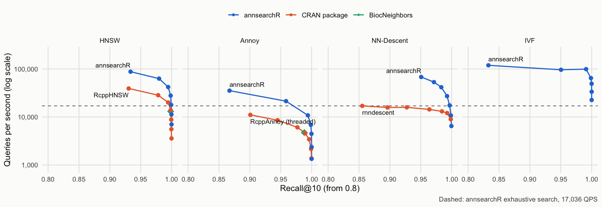
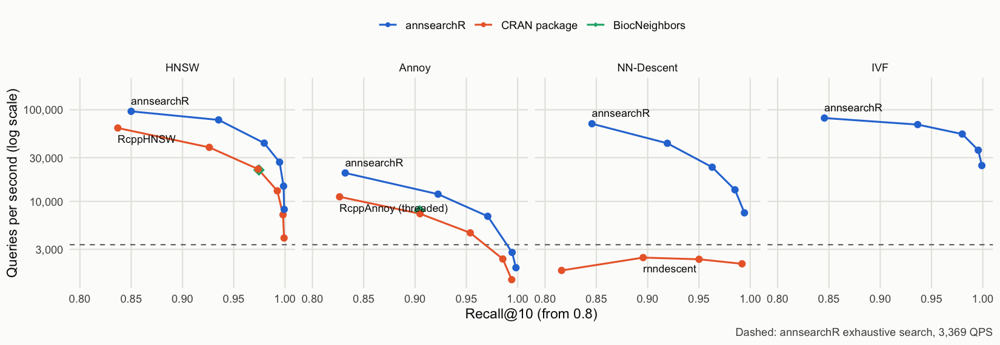
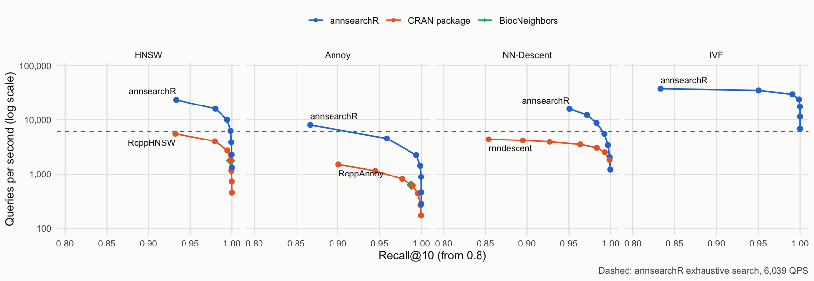
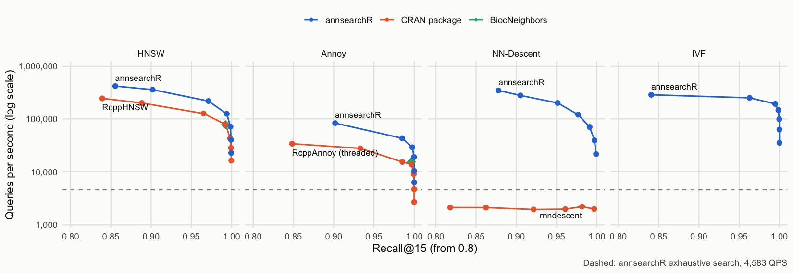

How does annsearchR stack up against the nearest neighbour packages R users
actually reach for? We ran the [ann-benchmarks](https://ann-benchmarks.com)
protocol on two of its standard datasets, plus single cell PCA data, and
compared every library at **equal recall**, not at equal settings. Two libraries with the same `ef_search`
can land at different recall, so "faster at the same parameters" says little.
Instead each library builds once, its search-time knob is swept, and we read
off the best queries per second (QPS) it reaches at recall@10 of 0.90, 0.95 and
0.99.

These are numbers from one machine on one day with annsearchR 0.3.0
(ann-search-rs 0.13.1), frozen here rather than rebuilt with the package. Everything needed to rerun them is in
[`inst/benchmarks/`](https://github.com/GregorLueg/annsearchR/tree/main/inst/benchmarks).

## Setup

* **Machine:** Apple M1 Max, 10 cores (8 performance, 2 efficiency), macOS.
* **Datasets:**
  [Fashion-MNIST](https://github.com/zalandoresearch/fashion-mnist), 60,000 x
  784 (28 x 28 greyscale product photos), and SIFT-128, 1,000,000 x 128 (local
  image descriptors). Both use 10,000 held-out queries, k = 10, Euclidean
  distance and the ground truth that ships with the HDF5 files.
* **Matched build parameters:** HNSW at M = 16 and ef_construction = 200;
  Annoy at 50 trees; NN-Descent graphs of degree 30.
* **Swept at query time:** HNSW and NN-Descent `ef_search` from 10 to 640;
  Annoy `search_k` from 500 to 50,000; IVF `nprobe` from 2 to 128;
  rnndescent's `epsilon` from 0 to 0.3.
* **Libraries:** annsearchR (Rust, via ann-search-rs), RcppHNSW (hnswlib),
  RcppAnnoy (Spotify's Annoy), BiocNeighbors (KMKNN, plus hnswlib and Annoy),
  rnndescent (NN-Descent), FNN and RANN (exact kd-trees).

Each point is a single timed run over all 10,000 queries. Two repeat runs of
the Fashion-MNIST sweep agreed within about 5% for most points, but one
rnndescent point moved 1.5x between runs, so read small gaps as ties.

## Results

Each panel is one algorithm family. Up and to the right is better. The dashed
line is annsearchR's exact brute-force search: an approximate index below it
isn't worth building on that data.

### Fashion-MNIST, 10 threads



| Method | Library | Build (s) | QPS @ 0.90 | QPS @ 0.95 | QPS @ 0.99 |
|---|---|---:|---:|---:|---:|
| hnsw | **annsearchR** | 3.6 | 87,719 | 62,893 | 42,017 |
| hnsw | RcppHNSW | 8.6 | 39,216 | 28,409 | 20,080 |
| hnsw | BiocNeighbors | 67.6 | 13,089 | 13,089 | 13,089 |
| nndescent | **annsearchR** | 2.3 | 68,027 | 68,027 | 27,174 |
| nndescent | rnndescent | 16.3 | 15,873 | 14,388 | 12,063 |
| ivf | **annsearchR** | 0.4 | 99,010 | 99,010 | 99,010 |
| annoy | **annsearchR** | 1.7 | 21,368 | 21,368 | 10,811 |
| annoy | RcppAnnoy (threaded) | 16.6 | 11,074 | 6,083 | 3,440 |
| annoy | BiocNeighbors | 16.1 | 4,737 | 4,737 | n/a |
| exhaustive | **annsearchR** | 0.1 | 17,036 | 17,036 | 17,036 |
| kmknn | **annsearchR** | 0.4 | 25,000 | 25,000 | 25,000 |
| kmknn | BiocNeighbors | 116.0 | 759 | 759 | 759 |
| kd_tree | RANN | - | 30 | 30 | 30 |
| kd_tree | FNN | - | 30 | 30 | 30 |

### SIFT-128, 10 threads



| Method | Library | Build (s) | QPS @ 0.90 | QPS @ 0.95 | QPS @ 0.99 |
|---|---|---:|---:|---:|---:|
| hnsw | **annsearchR** | 44.1 | 77,519 | 43,290 | 26,810 |
| hnsw | RcppHNSW | 84.9 | 38,911 | 22,523 | 13,055 |
| hnsw | BiocNeighbors | 572.6 | 22,026 | 22,026 | n/a |
| nndescent | **annsearchR** | 20.8 | 43,103 | 23,641 | 7,508 |
| nndescent | rnndescent | 188.8 | 2,338 | 2,338 | 2,087 |
| ivf | **annsearchR** | 1.1 | 68,966 | 54,348 | 36,232 |
| annoy | **annsearchR** | 7.2 | 12,005 | 6,887 | 2,778 |
| annoy | BiocNeighbors | 82.9 | 7,911 | n/a | n/a |
| annoy | RcppAnnoy (threaded) | 87.4 | 7,342 | 4,543 | 1,400 |
| exhaustive | **annsearchR** | 0.4 | 3,369 | 3,369 | 3,369 |
| kmknn | **annsearchR** | 1.4 | 7,231 | 7,231 | 7,231 |
| kmknn | BiocNeighbors | 858.9 | 255 | 255 | 255 |
| kd_tree | RANN | - | 6 | 6 | 6 |
| kd_tree | FNN | - | 6 | 6 | 6 |

### Fashion-MNIST, 1 thread

The ann-benchmarks convention, and the fair fight for the single-threaded
RcppAnnoy, FNN and RANN.



| Method | Library | Build (s) | QPS @ 0.90 | QPS @ 0.95 | QPS @ 0.99 |
|---|---|---:|---:|---:|---:|
| hnsw | **annsearchR** | 17.3 | 23,310 | 15,848 | 9,970 |
| hnsw | RcppHNSW | 67.6 | 5,568 | 4,016 | 2,711 |
| hnsw | BiocNeighbors | 67.3 | 1,769 | 1,769 | 1,769 |
| nndescent | **annsearchR** | 10.8 | 15,773 | 15,773 | 5,519 |
| nndescent | rnndescent | 76.7 | 3,912 | 3,495 | 2,507 |
| ivf | **annsearchR** | 0.5 | 34,602 | 34,602 | 29,412 |
| annoy | **annsearchR** | 5.7 | 4,527 | 4,527 | 2,224 |
| annoy | RcppAnnoy | 15.8 | 1,510 | 810 | 440 |
| annoy | BiocNeighbors | 15.2 | 622 | 622 | n/a |
| exhaustive | **annsearchR** | 0.2 | 6,039 | 6,039 | 6,039 |
| kmknn | **annsearchR** | 0.5 | 5,970 | 5,970 | 5,970 |
| kmknn | BiocNeighbors | 116.8 | 100 | 100 | 100 |
| kd_tree | FNN | - | 30 | 30 | 30 |
| kd_tree | RANN | - | 30 | 30 | 30 |

## What the numbers say

* **HNSW:** annsearchR runs about 2x the queries per second of RcppHNSW at
  every recall target on both datasets with 10 threads, and builds 1.9 to 2.4x
  faster. Recall at the same `ef_search` is within about 0.02 of RcppHNSW's,
  so the graphs are of the same quality; the Rust search is just quicker. On
  one thread the gap widens to 3.7 to 4.2x: RcppHNSW gains more from extra
  threads than annsearchR does.
* **IVF:** builds in 0.4 s on Fashion-MNIST and 1.1 s on SIFT and, with 10
  threads, is the fastest index at every recall target on
  Fashion-MNIST and at 0.95 and 0.99 on SIFT. HNSW still wins at recall 0.90
  on SIFT. No other R package ships IVF.
* **NN-Descent:** against rnndescent, 4.3x faster at recall 0.90 on
  Fashion-MNIST and 18x on SIFT, with builds 7 to 9x faster.
* **Annoy:** RcppAnnoy has no threaded query of its own. The "(threaded)"
  rows do what Seurat does: save the index to a temporary file and search it
  from C++ over a RcppThread pool (an idea from uwot), save cost included.
  annsearchR still does 1.5 to 3.5x the QPS and builds 10 to 12x faster.
* **Exact search:** annsearchR's KMKNN is now its fastest exact search on
  10 threads: 1.5x its own brute force on Fashion-MNIST and 2.1x on SIFT, and
  28 to 33x BiocNeighbors' KMKNN. On one thread the two are level. Both beat
  the single-threaded FNN and RANN kd-trees by a mile, about 570x for brute
  force on Fashion-MNIST.
* **Builds:** BiocNeighbors builds its HNSW, Annoy and KMKNN indices on one
  thread whatever `num.threads` says, which is where its 9.5 and 14.3 minute
  SIFT builds come from.

## Single cell: Tahoe PCA

Queries per second on held-out points is the ann-benchmarks question. Single
cell asks a different one: how long until I have the kNN graph over all my
cells? Every UMAP and Leiden run starts from that graph. In the big R
frameworks it comes from Annoy: Seurat's `FindNeighbors()` builds it with
RcppAnnoy, scrapper's `buildSnnGraph()` with BiocNeighbors' Annoy. Both build
the 50 trees on one thread. So here's the time to the graph on real data,
followed by the usual sweep.

* **Data:** one plate of Tahoe-100M, 2,857,393 cells, 32 principal components. Random subsets of 500k and 1M
  cells, plus 10,000 held-out cells for the query sweep. Built by
  `prep_tahoe.R` in the same HDF5 layout as the ann-benchmarks files.
* **Settings:** k = 15, Euclidean distance, 10 threads, same machine and same
  build parameters as above.

### Time to the full kNN graph

Each point is build plus self-query, from the raw matrix to the k = 15 graph
over every cell, each cell counted as its own first neighbour. Every
index builds once and its search knob gets swept. NN-Descent has no search
step: the graph falls out of the descent, either read off the index
(`$extract_knn()`) or from `knn_graph_nndescent()`, which never keeps an index
around. Recall comes from 10,000 random cells against the exact graph.

Seconds to the full graph at each recall target:

| Method | Library | 500k @ 0.90 | 500k @ 0.95 | 500k @ 0.99 | 1M @ 0.90 | 1M @ 0.95 | 1M @ 0.99 |
|---|---|---:|---:|---:|---:|---:|---:|
| ivf | **annsearchR** | 1.2 | 1.2 | 1.5 | 2.9 | 2.9 | 3.8 |
| nndescent, `knn_graph_nndescent()` | **annsearchR** | 2.1 | 2.1 | 2.1 | 4.9 | 4.9 | 4.9 |
| nndescent, `$extract_knn()` | **annsearchR** | 2.4 | 2.4 | 2.4 | 6.2 | 6.2 | 6.2 |
| kmknn (exact) | **annsearchR** | 4.2 | 4.2 | 4.2 | 12.6 | 12.6 | 12.6 |
| annoy | **annsearchR** | 3.9 | 6.7 | 6.7 | 8.7 | 15.6 | 23.5 |
| hnsw | **annsearchR** | 7.8 | 7.8 | 8.7 | 18.6 | 19.1 | 24.2 |
| annoy | RcppAnnoy (threaded) | 29.4 | 32.6 | 39.7 | 68.1 | 85.0 | 108.7 |

* **Annoy is the slow part of the pipeline.** RcppAnnoy needs 68 s for the
  1M graph at recall 0.90, most of it the single-threaded build. annsearchR's
  own Annoy gets there in 8.7 s.
* **Exact beats approximate.** KMKNN gets the exact graph over 1M cells in
  12.6 s, 5x faster than RcppAnnoy at recall 0.90.
* **NN-Descent is the no-brainer.** 0.995 recall in 4.9 s at 1M, nothing to
  tune. The graph is the build, so skipping the index saves another 20%.
* **IVF is the fastest at every recall target**, 23x RcppAnnoy at 1M and
  recall 0.90.
* **HNSW is the wrong tool for this job.** Its query is nearly free, but the
  16.5 s build dominates when you only want one graph.

### Queries per second, 1M cells

The ann-benchmarks protocol on the 1M subset, with 10,000 held-out cells as
queries and recall@15.



| Method | Library | Build (s) | QPS @ 0.90 | QPS @ 0.95 | QPS @ 0.99 |
|---|---|---:|---:|---:|---:|
| hnsw | **annsearchR** | 16.1 | 357,143 | 217,391 | 125,000 |
| hnsw | RcppHNSW | 20.7 | 126,582 | 126,582 | 78,740 |
| hnsw | BiocNeighbors | 152.1 | 77,519 | 77,519 | 77,519 |
| nndescent | **annsearchR** | 10.1 | 277,778 | 200,000 | 70,423 |
| nndescent | rnndescent | 151.0 | 2,202 | 2,202 | 1,983 |
| ivf | **annsearchR** | 0.4 | 250,000 | 250,000 | 192,308 |
| annoy | **annsearchR** | 2.2 | 83,333 | 43,103 | 29,070 |
| annoy | RcppAnnoy (threaded) | 39.1 | 27,778 | 15,408 | 13,889 |
| annoy | BiocNeighbors | 35.4 | 15,408 | 15,408 | 15,408 |
| exhaustive | **annsearchR** | 0.1 | 4,583 | 4,583 | 4,583 |
| kmknn | **annsearchR** | 0.4 | 56,497 | 56,497 | 56,497 |
| kmknn | BiocNeighbors | 125.2 | 15,898 | 15,898 | 15,898 |
| kd_tree | RANN | - | 146 | 146 | 146 |
| kd_tree | FNN | - | 138 | 138 | 138 |

Same picture as ann-benchmarks: annsearchR's Annoy does 2 to 3x the QPS of
RcppAnnoy and builds 17x faster, HNSW is 1.6 to 2.8x RcppHNSW, NN-Descent 35
to 126x rnndescent, and BiocNeighbors' single-threaded builds take 2 to 2.5
minutes at 1M.

## Caveats

* **Brute force isn't single-core even on "1 thread".** On macOS the
  exhaustive index runs large batches through Apple Accelerate. At "1 thread"
  it worked out to roughly 574 GFLOP/s on Fashion-MNIST, far more than one
  core can do, so read its 1-thread numbers as Accelerate's. The approximate
  indices don't use that path.
* **BiocNeighbors HNSW and Annoy are single points.** Its prebuilt index bakes
  the search parameter in, so sweeping it would mean one rebuild per point. We
  matched it to the middle of the sweep instead (`ef.search = 80`,
  `search_k = 5,000`).
* **rnndescent spends its time per query, not in the search.** Its QPS stays
  flat across the whole `epsilon` sweep while recall climbs from 0.59 to 0.99
  on SIFT. A fixed cost per call is about 0.25 s, about 5% of a 10,000-query
  call; the rest is roughly 0.44 ms per query regardless of `epsilon`. Where
  exactly that goes is inside its C++ code and wasn't profiled further.
* **SIFT ground truth:** annsearchR's exhaustive search reaches recall
  0.9993 against the file's own ground truth, not 1.0000. Ties between
  integer-valued descriptors are the likely reason; nothing in the tables
  depends on it.

## Rerunning

```sh
# downloads the HDF5 files once into tools::R_user_dir("annsearchR", "cache")
Rscript inst/benchmarks/bench_ann_benchmarks.R fashion-mnist-784-euclidean 10
Rscript inst/benchmarks/bench_ann_benchmarks.R sift-128-euclidean 10

# Tahoe: build the HDF5 files from a cells x 32 PCA matrix, then sweep and
# time the full kNN graph
Rscript inst/benchmarks/prep_tahoe.R pca_data.qs2 <cache dir>
Rscript inst/benchmarks/bench_ann_benchmarks.R tahoe-1m-32-euclidean 10
Rscript inst/benchmarks/bench_knn_graph.R tahoe-1m-32-euclidean 10

# plots from inst/benchmarks/results/*_sweep.csv
Rscript inst/benchmarks/plot_results.R
```

On SIFT the index builds alone add up to about 32 minutes on the machine above,
most of it in the single-threaded BiocNeighbors and RcppAnnoy builds.
